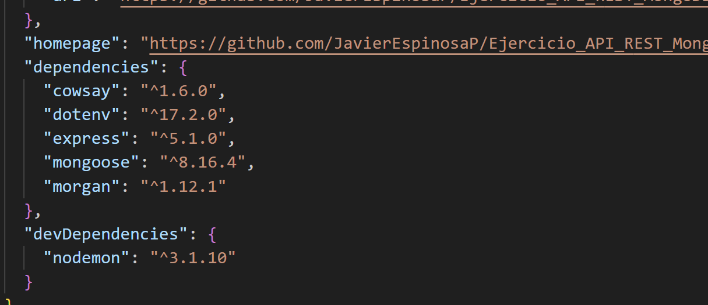
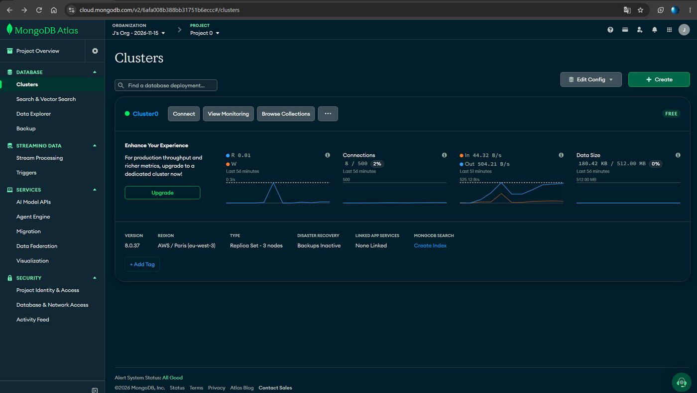
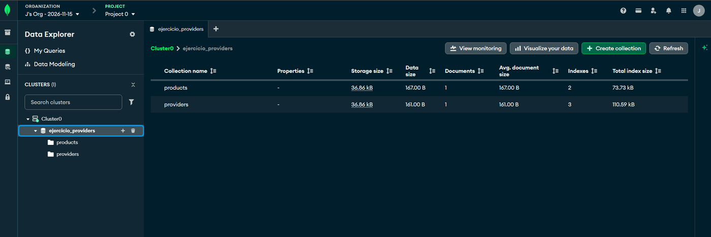
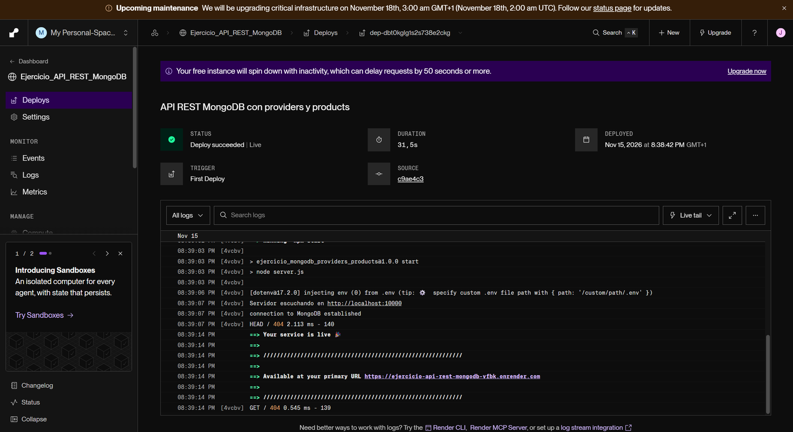
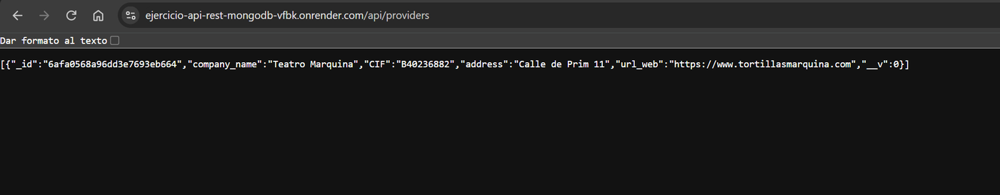
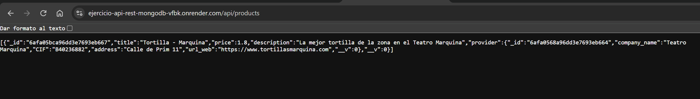
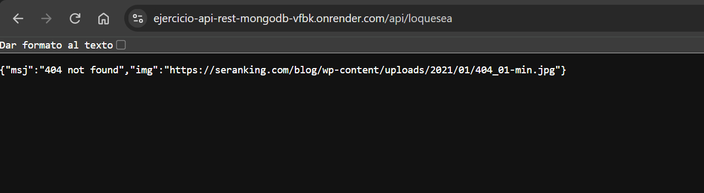

# API REST con MongoDB + Mongoose: Providers y Products

API REST desarrollada con **Node.js, Express y Mongoose**, con la base de datos en **MongoDB Atlas** y el servidor desplegado en **Render**.

| | |
|---|---|
| **API en producción** | https://ejercicio-api-rest-mongodb-vfbk.onrender.com |
| **Repositorio** | https://github.com/julkpront/Ejercicio_API_REST_MongoDB |

> **Aviso (plan gratuito):** Render duerme el servidor tras 15 minutos sin peticiones. La primera petición después puede tardar cerca de 1 minuto; las siguientes responden con normalidad.

---

## Índice

1. [Requisitos del ejercicio](#1-requisitos-del-ejercicio)
2. [Estructura del proyecto](#2-estructura-del-proyecto)
3. [Modelo de datos y relación](#3-modelo-de-datos-y-relación)
4. [Endpoints](#4-endpoints)
5. [Códigos de respuesta](#5-códigos-de-respuesta)
6. [Pregunta del ejercicio: borrar un proveedor con productos](#6-pregunta-del-ejercicio-borrar-un-proveedor-con-productos)
7. [Evidencias del despliegue](#7-evidencias-del-despliegue)
8. [Ejecutar en local](#8-ejecutar-en-local)
9. [Tecnologías](#9-tecnologías)

---

## 1. Requisitos del ejercicio

| Requisito | Estado | Dónde verlo |
|---|---|---|
| Conexión a la BBDD externalizada en `config/db_mongo.js` | Hecho | Sección 2 |
| Morgan instalado y usado como middleware | Hecho | Capturas 1 y 4 |
| BBDD desplegada en MongoDB Atlas | Hecho | Capturas 2 y 3 |
| Servidor Express desplegado en Render | Hecho | Capturas 4 a 7 |
| Colección **Providers** (`company_name`, `CIF`, `address`, `url_web`) | Hecho | Sección 3 |
| Schema de **Products** relacionado con Providers (modelo normalizado) | Hecho | Sección 3 |
| CRUD completo de Providers y de Products | Hecho | Sección 4 |
| `populate()` en `GET /api/products` | Hecho | Captura 6 |
| `POST /api/products` busca primero el proveedor | Hecho | Sección 4 |
| Respuesta a la pregunta sobre borrar proveedores | Hecho | Sección 6 |

---

## 2. Estructura del proyecto

```
├── config/
│   └── db_mongo.js            # Conexión a MongoDB (lee MY_MONGO_URI del .env)
├── controllers/               # Validaciones y códigos HTTP
├── middlewares/               # Morgan y manejo del error 404
├── models/                    # Schemas de Mongoose (Provider y Product)
├── routes/                    # Rutas de la API
├── services/                  # Consultas a MongoDB
├── capturas/                  # Imágenes de este README
├── server.js                  # Arranque de Express
└── .env                       # Variables de entorno (NO se sube a GitHub)
```

Flujo de una petición: **ruta → controlador → servicio → modelo → MongoDB**.

La URI de conexión no está escrita en el código: se lee de la variable de entorno `MY_MONGO_URI`. En local se define en `.env`, y en Render en el apartado *Environment Variables*, así la contraseña de Atlas nunca llega al repositorio.

---

## 3. Modelo de datos y relación

**Provider**

| Campo | Tipo | Reglas |
|---|---|---|
| `company_name` | String | obligatorio, único |
| `CIF` | String | obligatorio, único |
| `address` | String | obligatorio |
| `url_web` | String | opcional |

**Product**

| Campo | Tipo | Reglas |
|---|---|---|
| `title` | String | obligatorio, único |
| `price` | Number | obligatorio, mínimo 0 |
| `description` | String | opcional |
| `provider` | ObjectId | obligatorio, `ref: 'Provider'` |

MongoDB no tiene claves foráneas como SQL. Cada producto guarda el `_id` de su proveedor, y `populate('provider')` sustituye ese `_id` por los datos completos del proveedor al consultar, de forma equivalente a un `JOIN`.

---

## 4. Endpoints

Base URL: `https://ejercicio-api-rest-mongodb-vfbk.onrender.com`

### Providers

| Método | Ruta | Descripción |
|---|---|---|
| GET | `/api/providers` | Lista todos los proveedores |
| POST | `/api/providers` | Crea un proveedor |
| PUT | `/api/providers` | Actualiza un proveedor (se identifica por `company_name`) |
| DELETE | `/api/providers` | Borra un proveedor (por `company_name`) |

Ejemplo de body (POST):

```json
{
  "company_name": "Panadería Central",
  "CIF": "B12345678",
  "address": "Calle Mayor 10, Madrid",
  "url_web": "https://panaderiacentral.example"
}
```

### Products

| Método | Ruta | Descripción |
|---|---|---|
| GET | `/api/products` | Lista productos con el proveedor completo (`populate`) |
| POST | `/api/products` | Crea un producto |
| PUT | `/api/products` | Actualiza un producto (se identifica por `title`) |
| DELETE | `/api/products` | Borra un producto (por `title`) |

Ejemplo de body (POST). Se envía el **nombre** del proveedor; la API lo busca primero y guarda su `_id`:

```json
{
  "title": "Barra de pan",
  "price": 1.2,
  "description": "Barra de pan artesanal",
  "provider": "Panadería Central"
}
```

Si el proveedor no existe, la API responde **404** y no crea el producto.

---

## 5. Códigos de respuesta

| Código | Cuándo |
|---|---|
| 200 | Consulta, actualización o borrado correctos |
| 201 | Recurso creado |
| 400 | Faltan campos obligatorios o los datos no son válidos |
| 404 | El proveedor o el producto no existe, o la ruta no existe |
| 409 | Duplicado (`company_name`, `CIF` o `title` repetidos) o proveedor con productos asociados |
| 500 | Error interno del servidor |

---

## 6. Pregunta del ejercicio: borrar un proveedor con productos

**¿Se puede borrar un proveedor que tiene productos?** Por defecto en MongoDB sí, porque no hay integridad referencial automática. Pero dejaría productos apuntando a un proveedor que ya no existe, y `populate` devolvería `null`.

**Solución aplicada:** antes de borrar, la API cuenta los productos del proveedor con `countDocuments({ provider: _id })`. Si tiene alguno, **no lo borra** y responde **409**. Primero hay que borrar sus productos.

---

## 7. Evidencias del despliegue

### 7.1 Morgan y dependencias instaladas
Morgan está en `dependencies` del `package.json`, para que Render lo instale en producción.



### 7.2 Base de datos en MongoDB Atlas
Cluster gratuito (M0) en AWS París, con la conexión activa.



Base de datos `ejercicio_providers` con las colecciones `providers` y `products`.



### 7.3 Servidor desplegado en Render
Estado *Deploy succeeded | Live*. En los logs se ve `connection to MongoDB established` (conexión con Atlas) y las líneas de **Morgan** (`GET / 404 0.545 ms`).



### 7.4 La API respondiendo en producción
`GET /api/providers`:



`GET /api/products` con **`populate`**: el campo `provider` llega con los datos completos del proveedor, no solo con su `_id`.



### 7.5 Manejo de rutas inexistentes (404)
Una ruta que no existe responde con un JSON y el código 404.



---

## 8. Ejecutar en local

1. Instalar dependencias:

```bash
npm install
```

2. Crear un archivo `.env` en la raíz del proyecto:

```
MY_MONGO_URI=mongodb://localhost:27017/ejercicio_providers
```

   Para usar Atlas, sustituir la URI por la cadena `mongodb+srv://...` del cluster. Nunca se sube este archivo a GitHub.

3. Arrancar el servidor:

```bash
npm run dev     # con nodemon
npm start       # con node
```

Por defecto escucha en `http://localhost:3000` (en Render usa el puerto que le asigna la variable `PORT`).

---

## 9. Tecnologías

Node.js · Express 5 · Mongoose 8 · MongoDB Atlas (M0 gratuito) · Render · Morgan · dotenv · nodemon
